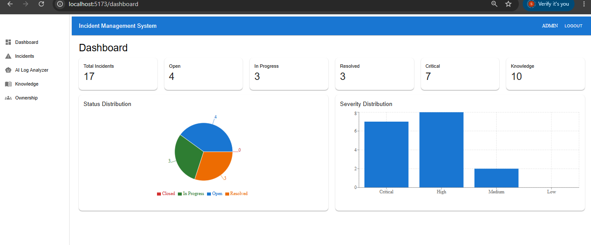
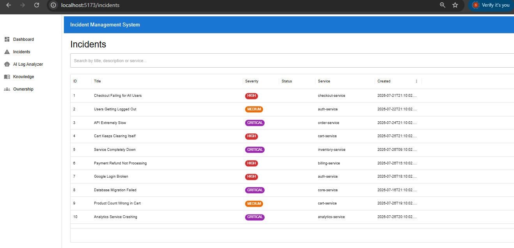
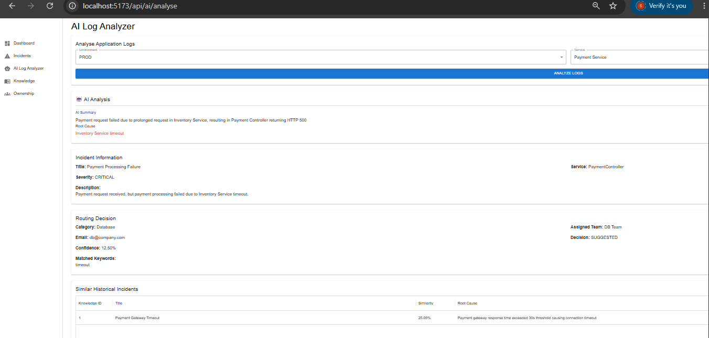
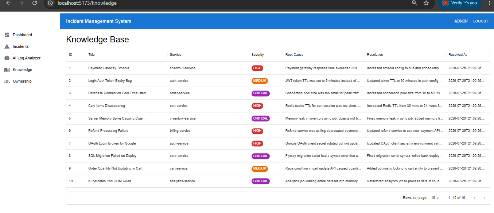
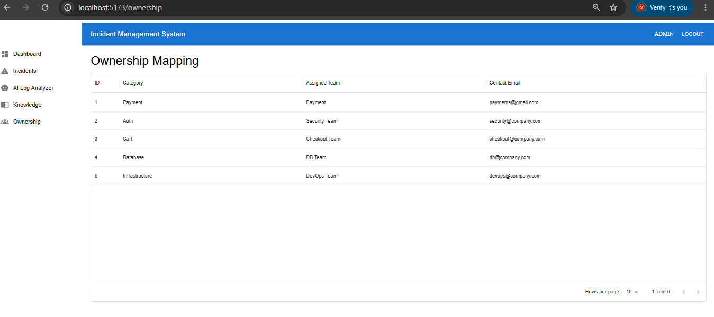
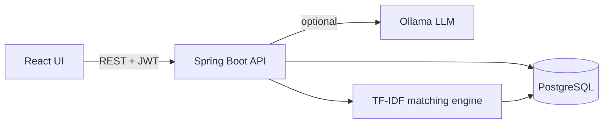

# AI-Assisted Production Incident Management System

A full-stack incident management system that helps support teams triage production incidents faster. New incidents are matched against a knowledge base of past incidents using TF-IDF and cosine similarity, automatically classified and routed to the owning team, and application logs can be analysed by a local LLM (Ollama) to suggest a root cause.

## Screenshots

### Dashboard
Live counts of incidents by status and severity, plus the size of the knowledge base.



### Incidents
Searchable incident list with severity badges, service and creation time.



### AI Log Analyzer
Pick an environment and service, and the system analyses the logs, summarises the failure, suggests a root cause, routes the incident to a team with a confidence score, and lists similar historical incidents.



### Knowledge Base
Past incidents with root cause and resolution, used for similarity matching.



### Ownership Mapping
Maps incident categories to the responsible team and contact, used by automatic routing.



## Features

- **Incident management**: create, list, search and fetch incidents through a REST API and a React UI
- **Similar incident matching**: TF-IDF and cosine similarity over past incidents and their resolutions
- **Automatic triage and routing**: classifies an incident by keywords, maps it to an owning team, and returns a confidence score and a decision (`AUTO ASSIGNED` or `SUGGESTED`)
- **AI log analysis**: a local LLM (Ollama) analyses application logs, writes a summary and proposes a probable root cause
- **Dashboard**: status and severity distribution at a glance
- **Security**: JWT authentication with role-based access control (`ADMIN`, `SUPPORT`, `VIEWER`)
- **Validation and error handling**: consistent JSON errors (400, 401, 403, 404, 500)

## Architecture



## Tech stack

| Layer | Technology |
|---|---|
| Backend | Java 21, Spring Boot, Spring Security, JPA/Hibernate |
| Frontend | React (`incident-ui`) |
| Database | PostgreSQL 16 |
| AI / matching | Ollama (optional), TF-IDF, cosine similarity |
| Build and test | Maven, JUnit, REST Assured |
| Performance testing | Grafana k6 |
| DevOps | Docker, Docker Compose, GitHub Actions |

## Run with Docker

Requires Docker Desktop.

```bash
docker compose up --build
```

The API is then available at `http://localhost:8080`, backed by PostgreSQL on port 5432.

On first start the app seeds three development users:

| User | Role |
|---|---|
| `admin1` | ADMIN |
| `support1` | SUPPORT |
| `viewer1` | VIEWER |

These are for local development only.

Log in to get a token:

```bash
curl -X POST http://localhost:8080/auth/login \
  -H "Content-Type: application/json" \
  -d '{"userName":"admin1","password":"admin123"}'
```

Then pass it as `Authorization: Bearer <token>` on the other endpoints.

The AI Log Analyzer needs [Ollama](https://ollama.com) running locally. The rest of the application works without it.

## Run the frontend

```bash
cd incident-ui
npm install
npm run dev
```

The UI runs at `http://localhost:5173`.

## API overview

| Method | Endpoint | Roles | Description |
|---|---|---|---|
| POST | `/auth/login` | public | Get a JWT |
| POST | `/api/incidents` | ADMIN | Create an incident |
| GET | `/api/incidents` | ADMIN, SUPPORT, VIEWER | List incidents |
| GET | `/api/incidents/{id}` | ADMIN, SUPPORT, VIEWER | Get one incident |
| GET | `/api/incidents/match?description=...` | ADMIN, SUPPORT, VIEWER | Find similar past incidents |
| POST | `/api/incidents/triage` | ADMIN, SUPPORT | Create, match and classify in one call |
| POST | `/api/ai/analyse` | authenticated | LLM log analysis (needs Ollama) |

## Tests and CI

API tests use REST Assured against the running application and a real PostgreSQL database. They cover:

- Login success and failure
- Unauthenticated requests are rejected
- Create and fetch an incident
- Request validation
- Role-based access (a `VIEWER` cannot create incidents)

Run them locally with Maven:

```bash
mvn verify
```

GitHub Actions runs the same tests on every push and pull request against a PostgreSQL service container, builds the Docker image, and runs the k6 load test against the application started with Docker Compose.

## Load testing with Grafana k6

[Grafana k6](https://grafana.com/docs/k6/latest/) is an open-source load testing tool where tests are written in JavaScript. The script in [`load-test/incidents.js`](load-test/incidents.js) simulates concurrent support engineers using the API.

**What the test does**

1. Logs in once as `admin1` (in k6's `setup()` stage) and shares the JWT with all virtual users
2. Each virtual user repeatedly calls:
    - `GET /api/incidents` (list incidents)
    - `GET /api/incidents/match?description=...` (TF-IDF similarity search, the most CPU-heavy read endpoint)
3. Checks that every response is `200` and pauses 1 second between iterations

**Load profile**

| Stage | Duration | Virtual users |
|---|---|---|
| Ramp up | 10 s | 0 to 10 |
| Hold | 30 s | 10 |
| Ramp down | 5 s | 10 to 0 |

**Pass/fail thresholds**

The run fails, and so does the CI job, if either threshold is crossed:

| Metric | Threshold |
|---|---|
| `http_req_failed` | below 1% of requests |
| `http_req_duration` | p(95) below 500 ms |

**Run it locally**

Start the application first (`docker compose up --build`), then install k6 (`winget install k6` on Windows, `brew install k6` on macOS) and run:

```bash
k6 run load-test/incidents.js
```

To point it at another environment:

```bash
k6 run -e BASE_URL=http://localhost:8080 load-test/incidents.js
```

At the end k6 prints a summary with request counts, latency percentiles and a pass or fail mark for each threshold.

**In CI**

The `load-test` job in [`.github/workflows/ci.yml`](.github/workflows/ci.yml) runs after the build and tests pass. It starts the app and database with `docker compose up`, waits until the login endpoint responds, runs the k6 script, and then tears everything down. Because it uses the same `docker-compose.yml` as local development, it also checks that the containerised setup works from a clean checkout.
